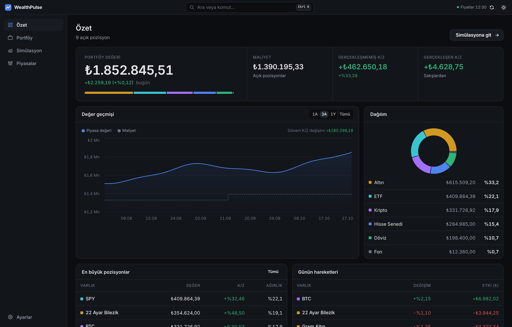
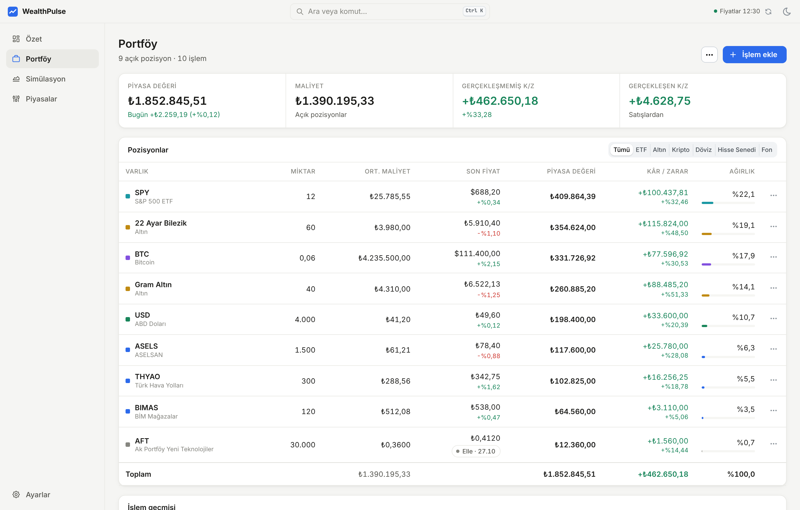
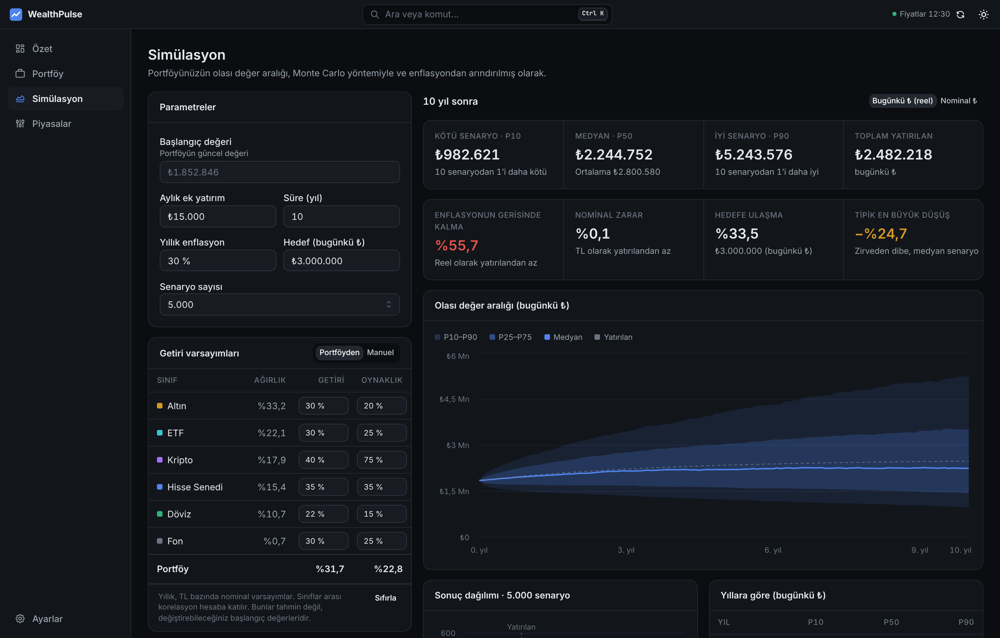
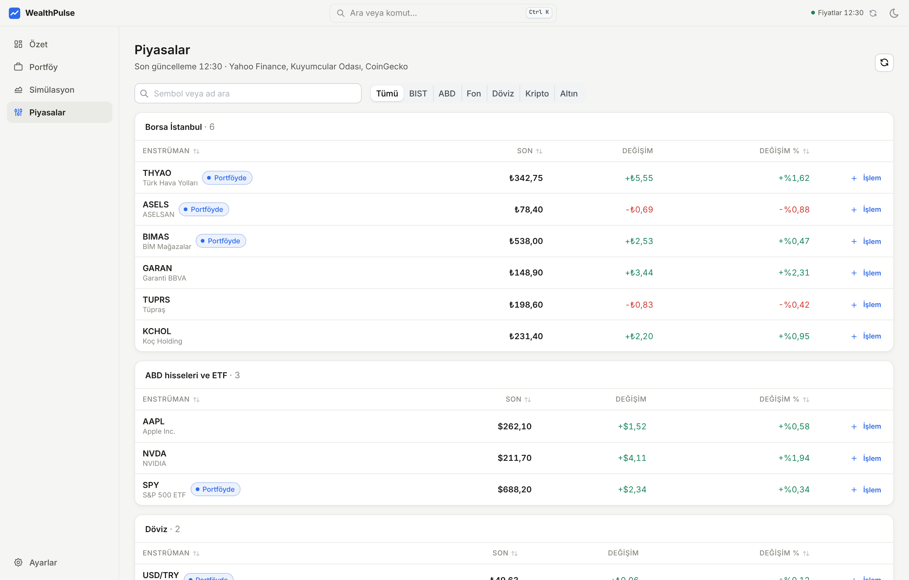
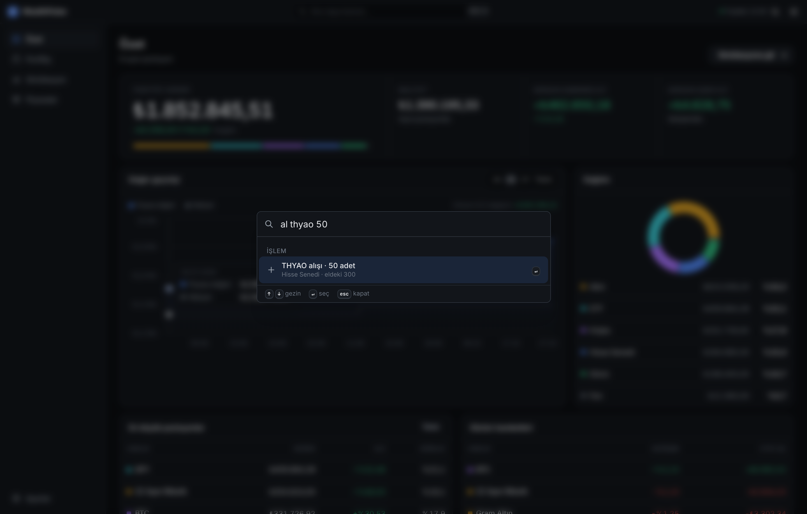
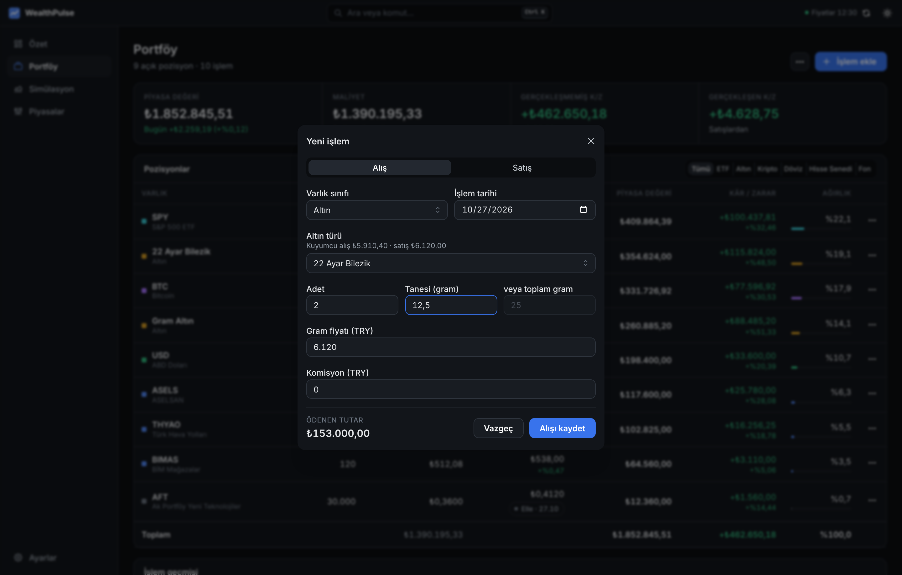

# WealthPulse

**Portfolio tracker and Monte Carlo simulator for investors in Turkey.**

Track Borsa İstanbul and US stocks, gold, foreign currency, funds and crypto in Turkish lira. Live prices keep the portfolio's value current, and a Monte Carlo simulation shows the range of outcomes your portfolio could reach, adjusted for inflation.

[](https://github.com/kaptanoguz/WealthPulse/releases/latest)
[](LICENSE)



> The user interface is in Turkish. The screenshots use a made-up sample portfolio, not real holdings or advice.

## Features

### Portfolio tracking

- **Trade ledger.** You record buys and sells, and holdings, average cost and P&L are worked out from them. The app doesn't let you sell more than you hold, including through back-dated trades.
- **TRY cost basis at the trade-date FX rate.** For a USD asset such as BTC or SPY, P&L includes the gain from a weaker lira, not only the price change.
- **Realized and unrealized P&L**, today's change, and allocation by asset class.
- **Live prices**:
  - Yahoo Finance for BIST and US stocks and ETFs
  - Kuyumcular Odası (via Truncgil) for gold and FX
  - CoinGecko for crypto
- **Gold and FX valuation** uses the jeweller's or bank's buying price, which is what you would get if you sold today. 22-carat bracelets can be entered by piece count and gram weight.
- **Manual prices** for assets without a price feed, such as most TEFAS funds. If a feed is down, the last known price stays in use and is marked as such.
- **Local data.** Everything stays on your device. You can back it up to a JSON file and restore it.



### Monte Carlo simulation

- **Starts from your portfolio.** It uses the portfolio's current value and allocation. Each asset class has its own expected return and volatility (all editable), and correlations between classes are applied, so diversification shows up in the result.
- **Inputs**: monthly contributions, an inflation rate, and an optional target in today's lira.
- **Outputs**:
  - P10 / P50 / P90 bands in real (today's lira) or nominal terms
  - probability of falling behind inflation
  - probability of a nominal loss
  - probability of reaching the target
  - typical maximum drawdown
  - a year-by-year table
- **Repeatable and responsive.** Runs are seeded, so the same inputs give the same result. The simulation runs in a Web Worker, so the page doesn't freeze.



### Markets and fast entry

- **Markets page.** Sortable tables for BIST, US stocks and ETFs, funds, FX, crypto and gold (with the buy/sell spread). From any row you can add a trade to your portfolio.
- **Command palette** (`Ctrl K` / `⌘K`):
  - Jump to pages and holdings.
  - Run commands such as refreshing prices, switching theme or downloading a backup.
  - Type `al THYAO 50` ("buy") or `sat btc` ("sell") to open a pre-filled trade form.

| Markets | Command palette |
| --- | --- |
|  |  |

| Trade form |
| --- |
|  |

### Interface

- **Built for reading numbers.** Neutral surfaces and a single accent color. Figures use tabular numerals and Turkish number formatting. Green and red only ever mean gain and loss.
- **Light and dark themes**, plus a "follow the system" option.
- **Nothing fake.** There are no placeholder profiles, notifications or demo prices. When a data source is down, the app tells you.

## Download

Installers are on the [Releases](https://github.com/kaptanoguz/WealthPulse/releases/latest) page. They are self-contained, so you don't need Node.js or npm.

| Platform | File | Notes |
| --- | --- | --- |
| Windows | `WealthPulse-<version>-win-x64.exe` | Not code-signed. If SmartScreen warns, choose **More info → Run anyway**. |
| macOS (Apple Silicon / Intel) | `WealthPulse-<version>-mac-arm64.dmg` / `-x64.dmg` | Not notarized. The first time, right-click the app and choose **Open**. |
| Linux (Debian, Ubuntu, Linux Mint) | `WealthPulse-<version>-linux-amd64.deb` | `sudo apt install ./WealthPulse-<version>-linux-amd64.deb` |
| Linux (any distribution) | `WealthPulse-<version>-linux-x86_64.AppImage` | `chmod +x` the file, then run it. |

Your portfolio is stored inside the app's own profile on your computer (`~/.config/WealthPulse` on Linux). To keep a backup, use **Ayarlar → Yedeği indir** (*Settings → Download backup*).

## Development

Requires Node.js 22.

```bash
npm install
npm run dev              # web app at http://localhost:3000
npm test                 # unit tests (portfolio, Monte Carlo, parsing, formatting)
npm run lint

# Desktop app
npm run electron:start   # build, then open the app in Electron
npm run dist:linux       # or dist:win / dist:mac: installers in dist-electron/
```

GitHub Actions (`.github/workflows/windows_build.yml`) builds the Windows, macOS and Linux installers:
- **Manual run**: the installers are attached to the run.
- **`v*` tag** (for example `v1.1.0`): they are also published as a release.

### How it fits together

- **Web app.** It's a Next.js (React, TypeScript, Mantine) app. API routes fetch market data on the server, so the browser never calls the price sources directly.
- **Desktop app.** Electron ships the Next.js standalone server and starts it with Electron's own Node runtime on `127.0.0.1:39871`. The port is fixed because the browser keeps your data separately for each address, and a fixed port keeps it across launches.
- **Core logic** is plain TypeScript with no UI dependencies, and has unit tests:

| File | Purpose |
| --- | --- |
| `lib/portfolio.ts` | Trade ledger → holdings, P&L, allocation, blending the return assumptions |
| `lib/montecarlo.ts` | Seeded simulation engine, percentiles, probabilities |
| `lib/portfolio-store.ts` | Storage (localStorage), price refresh, backup and restore |
| `lib/market-sources.ts` | Truncgil, Yahoo and CoinGecko fetchers |
| `app/api/prices/route.ts` | Live quotes and TRY FX rates for the assets you hold |
| `components/ui/primitives.tsx` | Shared panels, stat strips and chart tooltip |

### Optional modules

Income/expense tracking, a news feed, reports and an AI chat widget are in the codebase but switched off in [`lib/features.ts`](lib/features.ts). They stay off until they meet the same bar as the core: real data, persistence and tests. A disabled module is hidden from the menu, and its route returns 404.

## Disclaimer

WealthPulse is for information only and is not investment advice. Simulation results follow from the assumptions you enter; they are not forecasts. Market data may be delayed.

## License

[MIT](LICENSE) © Recep Oğuz Yağbasan
